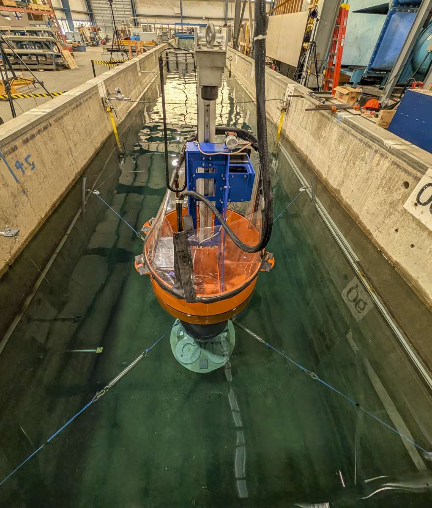

**TEAMERAOELUPA9** Software emulation of pneumatic compressed air system with forces actuated on LUPA in one body heave only and 6DOF configurations.

Duration: Fall 2026

Facility: LWF

Conditions tested: Regular and Random waves testing pneumatic system emulation

Goals:

* Demonstrate emulation of compressed air system with LUPA
    + Use motor/generator on LUPA to actuate force outputs from pneumatic model

