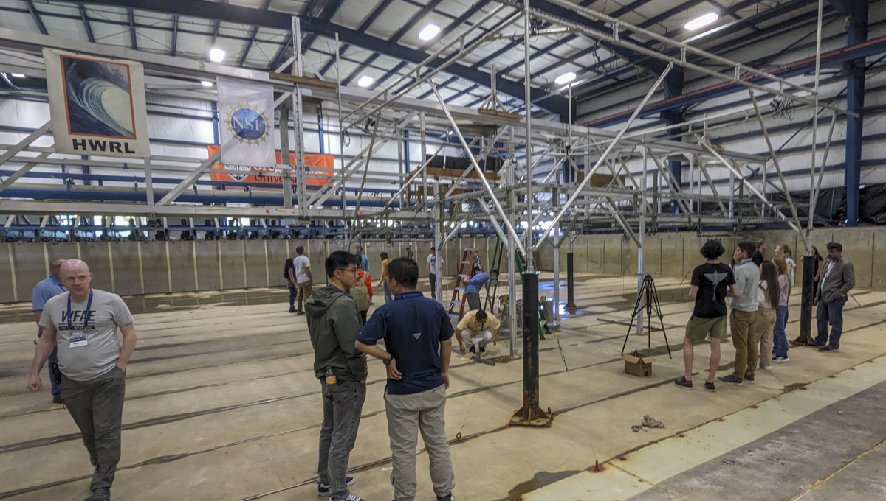

**WorkshopLUPA4** Testing of LUPA in the large wave flume (LWF).  Collecting system identification and validation data for TEAMER workshop.

Duration: Summer 2024

Facility: LWF

Conditions tested: Multisine reference input; Regular waves

Goals:

* Collect System Identification data for applying impedance matching model
    + Still water multisine reference signal input
    + Regular wave validation runs

